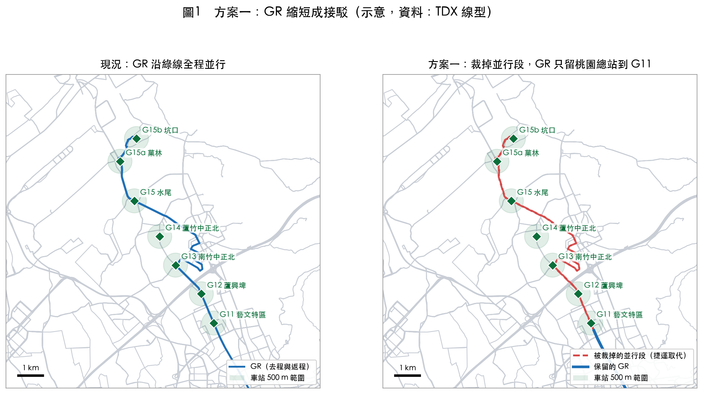
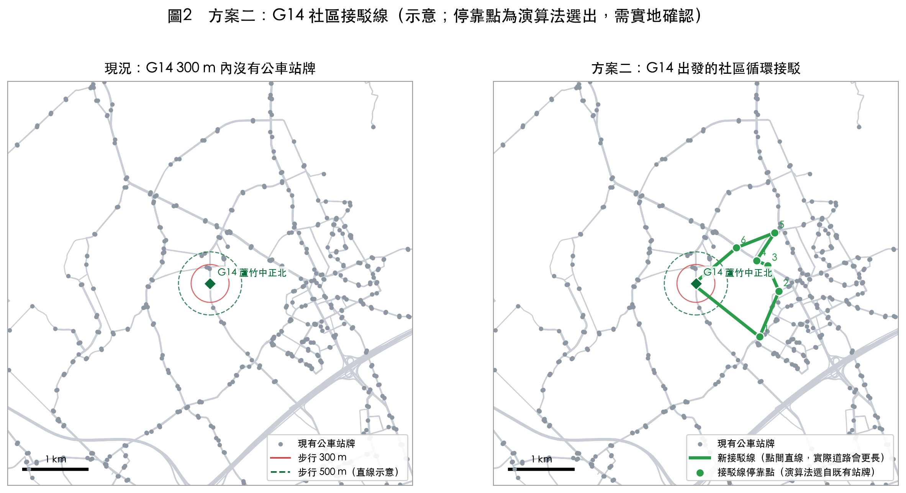
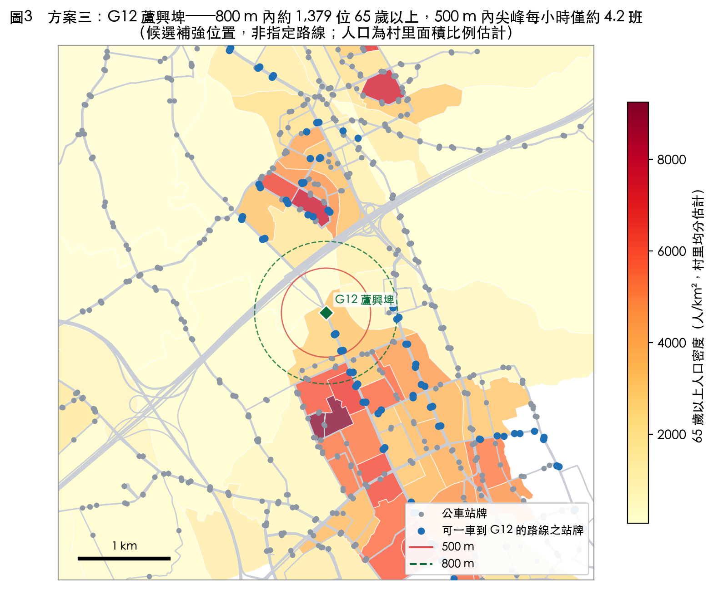
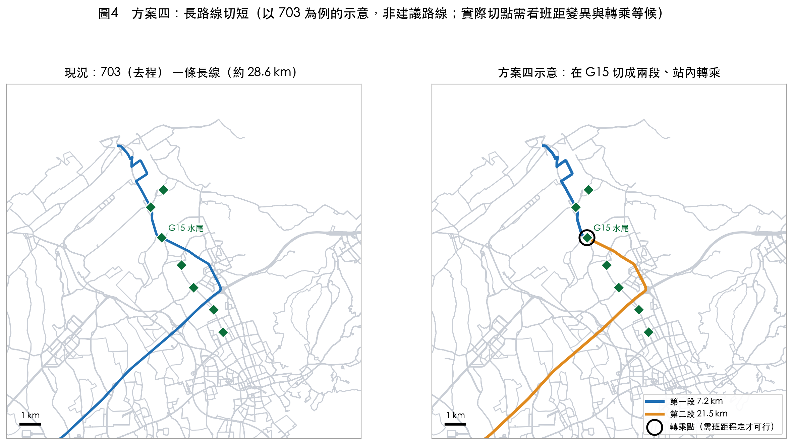
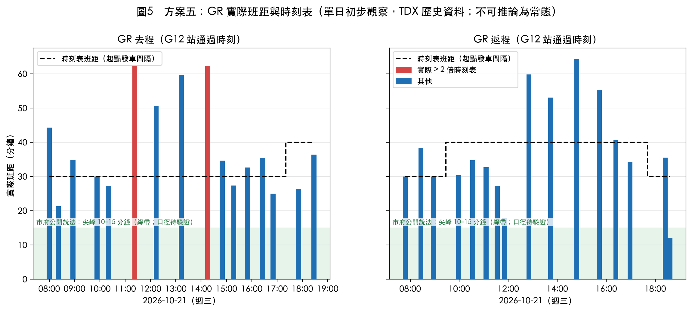

# 綠線通車後的公車改善方案（候選）

> 範圍：捷運綠線北段 G11 藝文特區至 G15b 坑口共 7 站。
> 性質：研究用的候選方案與示意，**不是市府決定**，也不指定具體路線。駕駛人力為「約當班次」估算，不代表可裁減人員。
> 資料：TDX 公車線型、站序、班表（115 年 10 月 24 日取得）；TDX 歷史即時位置（2026-10-21 單日）；OpenStreetMap；內政部戶政司村里人口。
> 圖由 `docs/scenario/make_figs.py` 產生，與決策平台用同一套算法（TDX 實際線型）。

## 設計原則

1. **班距穩定才裁切。** 被依賴的接駁線，班距變異須低於門檻；門檻由資料分布與市府排班規則決定，目前不預設數值。
2. **載客高的路線不降為桃小巴。** 需上下車量才能檢查，屬市府資料媒合需求。
3. **新線不可過長。** 單程長度與路口數設上限，超過就切段轉乘。

## 方案一：GR 縮短成接駁

**做法**：GR 有約 34%（單向約 5.8 km）的路線長度落在綠線車站 500 m 範圍內。裁掉並行段，只保留桃園總站到 G11。



- **依據**：GR 占全部重疊車公里的 22.0%，是班次加權後重疊最多的路線。
- **示意效果**：平日約當駕駛班次由 138.1 降到 133.8（假設時速 18 km/h、每班 8 小時，只含行駛時間，不含休息、空駛、備勤）。
- **代價**：G12、G15b 可一車到站的長者人數略減（G12 約 −33、G15b 約 −28），需搭配方案二、三補位。
- **驗證指標**：車公里、約當駕駛班次、各站可一車到站之 65 歲以上人口。

## 方案二：G14 社區接駁線

**做法**：從 G14 出發，繞周邊社區的循環接駁線（示意單程約 4.8 km，點間直線，實際道路會更長）。



- **依據**：G14 是接駁最弱的站：300 m 內沒有公車站牌，500 m 內尖峰每小時約 4.2 班。
- **示意效果**：可一車直達 G14 的 65 歲以上人口由約 1,018 人增到約 2,332 人。
- **限制**：停靠點是演算法從既有站牌挑出，需實地確認；班次與車型容量要有上下車量才能定。
- **驗證指標**：長者可一車直達人數、所需車型容量、接駁線班距變異。

## 方案三：G12 補強（長者多、接駁弱）

**做法**：增加 G12 附近的班次，或把現有路線改道經過 G12。圖中標示的是**候選補強位置**，不是指定路線。



- **依據**：G12 的 500 m 內尖峰每小時約 4.2 班，但 800 m 內約有 1,379 位 65 歲以上居民，是「長者多、接駁弱」最明顯的站。圖中藍點是可一車到 G12 的路線站牌，主要在東南側，西側與北側的長者聚落到站較不便。
- **與方案一的關係**：裁切 GR 之後，G12 一車到站人數不能變差，這是方案一的前提。
- **限制**：人口依村里面積比例分配（假設村內均勻），工業區、農地占比高的村里會失真。

## 方案四：長路線切短、站內轉乘

**做法**：沿幹道的長路線切成兩段，在車站轉乘，降低整條線脫班的連鎖影響。圖中以 703 去程為例，**僅為示意，不是建議路線**。



- **依據**：長線一處延誤會影響全程。切短後各段班距較容易穩定。
- **注意**：此例切成 7.2 km 與 21.5 km，第二段仍然很長，實際切點應依班距變異與轉乘等候決定。切短的前提是轉乘站班距穩定，否則轉乘等候會被放大，反而更差。
- **驗證指標**：班距變異係數 cv、轉乘步行距離、轉乘等候時間。

## 方案五：班次改善（不改路線）

**做法**：把班表改成較固定的班距，並與捷運班次對接。



- **單日初步觀察（2026-10-21，週三）**：GR 在 G12 的實際班距多落在 20–60 分鐘（最短約 12 分、最長約 64 分），時刻表為 30–40 分鐘；去程有 2 次超過時刻表 2 倍。市府公開說法是 GR 尖峰 10–15 分鐘一班，與資料不一致，可能是 GR 與 GR2 合併計算或口徑不同，**列為【待驗證】**。
- **限制**：只有一個平日，不能推論為常態。時刻表只有起點發車時刻，以起點班距代替計時點班距屬假設。
- **驗證指標**：cv、大間隔比例（實際 > 2 倍時刻表）、併班比例（< 0.25 倍）。倍數門檻為暫定。

## 建議的組合

| 角色 | 方案 | 理由 |
|---|---|---|
| 提案主軸 | 一 + 二 + 三 | 資料已算過，可說明「省多少、補誰」，三者互補 |
| 回應「可靠度先達標」 | 四、五 | 需要多日班距資料；目前只有單日 |

## 目前做不到、不可寫成已完成的事

- **上下車量**：未公開，需市府提供；沒有它就無法檢查「高載客路線降桃小巴」，也無法算車型容量。
- **多日班距**：目前只有 10/21 一個平日；通車前基準仍在累積。
- **長者意願與可接受步行距離**：尚未做任何問卷或訪談。
- **G15b 車站位置**：以機場捷運 A11 站估計，需官方出入口複核。

## 圖的來源與重新產生

```bash
python docs/scenario/make_figs.py     # 在儲存庫根目錄；需 geopandas、matplotlib
```

使用 AI 協助的部分（繪圖程式、文字整理），報名時須在報名表寫明工具名稱與使用方式。
